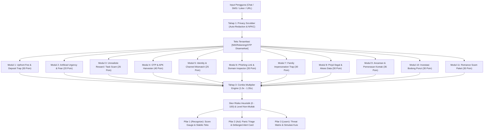

# 🛡️ The Trust Trap Guardian
> **Detektor Heuristik Rekayasa Sosial & Penipuan Digital Indonesia**  
> *Terinspirasi dari model transparansi VirusTotal untuk pertahanan penipuan digital*  
> *Karya Inovasi Kompetisi Web Development MIT-WEEK 2026 - Tim Nanti Ajah (MIT-041)*

[](https://vitejs.dev/)
[](https://react.dev/)
[](https://tailwindcss.com/)
[](scripts/verifyEngine.mjs)
[](https://opensource.org/licenses/MIT)

🌐 **Live Production App:** [https://trusttrapguardian.vercel.app/](https://trusttrapguardian.vercel.app/)  
📂 **Dokumentasi Arsitektur Lengkap:** [docs/ARCHITECTURE.md](docs/ARCHITECTURE.md)

---

## 📌 1. Latar Belakang & Konsep: Mengapa Terinspirasi dari VirusTotal?

Di Indonesia, mayoritas kejahatan siber yang menyasar generasi muda dan masyarakat umum di WhatsApp, Telegram, dan Direct Message berakar dari teknik **Rekayasa Sosial (Social Engineering)**: manipulasi psikologis yang mengeksploitasi kepanikan (*artificial urgency*), rasa tergiur imbalan cepat (*greed heuristic*), atau rasa bersalah dan empati korban.

Platform populer **VirusTotal** memungkinkan pengguna memeriksa file atau URL dengan tingkat transparansi tinggi. **TrustTrap Guardian** mengadopsi model transparansi tersebut untuk **mendeteksi manipulasi rekayasa sosial dan penipuan digital**. Sistem ini bukan menjalankan banyak mesin independen di server luar, melainkan satu set aturan heuristik berbasis pola yang bekerja transparan 100% lokal di browser pengguna:
* **VirusTotal Asli:** Memeriksa trojan, virus teknis, dan hash biner file menggunakan puluhan antivirus vendor.
* **TrustTrap Guardian:** Membedah pancingan psikologis (loker BUMN palsu, *task scam* misi deposit, pancingan file malware `.APK`, jeratan pinjol ilegal, dan desakan transfer dalam hitungan menit) menggunakan aturan heuristik pola percakapan.

---

## 🏛️ 2. Arsitektur 3 Pilar Solusi (Recognize, Act, Learn)

```
TrustTrap Guardian
 ├── 1. RECOGNIZE (Bedah Bukti Heuristik Transparan)
 │    ├── Omnibox Scam Analyzer (Teks / Link / Loker + Shortcut Ctrl+Enter)
 │    ├── 6 Preset 1-Klik Pengujian Juri (Entitas Fiktif Aman)
 │    ├── Radial Score Gauge (0 - 100) & Transparansi Rumus Multiplier
 │    ├── Explainable Evidence Highlighter & Sensor Otomatis Data Sensitif
 │    └── Seamless Handoff ke Jalur Penyelamatan Darurat
 ├── 2. ACT (Langkah Penyelamatan Darurat & Triage)
 │    ├── Psychological First Aid Banner (Anti-Shame Loop)
 │    ├── Mode Triage Cepat Berbasis Hick's Law (Baru Terima Chat vs Terlanjur Transfer)
 │    ├── Time-Boxed Flash Action Cards (Detik 0-30 & Menit 1-60)
 │    ├── Checklist Interaktif dengan Endowed Progress Effect (15% -> 100%)
 │    ├── Panduan Cepat per Modus & Kanal Bantuan Resmi Nasional (IASC OJK, SPKT Polri)
 │    └── Guardian Alert Card dengan URL Defanging Siap Bagi ke WhatsApp
 └── 3. LEARN (Simulasi & Edukasi Rekayasa Sosial)
      ├── Simulasi Kuis Interaktif "Spot The Trap" (8 Skenario Lengkap Termasuk Pesan Resmi)
      ├── Pengacakan Pilihan Jawaban Acak (Randomized Options) & Umpan Balik Edukatif
      ├── Integrasi Dua Arah: Tombol Uji Skenario Langsung ke Scanner Tab 1
      ├── Kamus 11 Pola Manipulasi Rekayasa Sosial (Threat Matrix)
      └── Jaminan Local-First Privacy (Zero External Data Storage)
```

---

## 🔄 3. Diagram Alur Pemrosesan 4 Tahap (Mermaid Flowchart)



---

## 🧠 4. Pendekatan Psikologi Kognitif & HCI (Human-Computer Interaction)

Berbeda dari pemindai teknis biasa yang pasif, antarmuka **TrustTrap Guardian** dirancang khusus menggunakan prinsip psikologi perilaku untuk mengatasi kondisi mental korban penipuan (*panic paralysis*):

1. **Hick's Law (Penyederhanaan Jalur Keputusan):**  
   Saat mengalami kepanikan, kemampuan kognitif manusia menurun drastis. Sistem memangkas kebingungan dengan membagi jalur penyelamatan menjadi **2 pilihan biner tegas**: *Baru Terima Chat* (tindakan preventif) vs *Terlanjur Klik / Transfer* (tindakan mitigasi kilat).
2. **Cognitive Load Theory (Pengurangan Beban Memori Kerja):**  
   Menyajikan instruksi darurat dalam format kotak *Time-Boxed* dengan label **"PRIORITAS KOGNITIF UTAMA"**:
   - **Detik 0-30:** Putus koneksi internet (Mode Pesawat) agar malware `.APK` tidak dapat menyedot data SMS OTP.
   - **Menit 1-60:** Segera hubungi call center resmi bank di belakang kartu ATM untuk membekukan rekening tujuan sebelum saldo dikuras.
3. **Affective Design & Regulasi Emosi (*Anti-Shame Loop*):**  
   Menghadirkan *Psychological First Aid Banner* (*"Anda tidak sendirian & jangan malu melapor"*) untuk mematahkan stigma rasa malu dan rasa bersalah (*victim blaming*) yang kerap menjadi penghambat utama korban melaporkan kejadian ke OJK/IASC.
4. **Endowed Progress Effect:**  
   Checklist darurat secara visual dimulai dari **progres awal 15%** saat pengguna membuka panduan penyelamatan. Hal ini memberikan dorongan motivasi awal (*endowment*) agar korban termotivasi menyelesaikan kelima protokol penyelamatan hingga 100%.

---

## ⚙️ 5. Scam Heuristic Engine (11 Modul Deteksi)

Engine bekerja secara sekuensial dan dijalankan seketika di peramban:
1. **Tahap 1: Sensor Privasi Otomatis (Auto-Redaction):** Mengaburkan NIK 16-digit, Nomor Rekening Bank, Nomor HP, dan Kode OTP menjadi token aman `[DATA_DISAMARKAN]` secara lokal. Termasuk sanitasi *zero-width spaces* dan normalisasi unicode NFKC.
2. **Tahap 2: Evaluasi 11 Modul Independen:**
   * **Modul 1: Upfront Fee & Deposit Trap (Bobot 30):** Permintaan biaya di muka, uang jaminan, deposit misi, atau modus rekening penampung aman.
   * **Modul 2: Artificial Urgency & Fear (Bobot 20):** Tekanan batas waktu sempit ("dalam 15 menit", "kuota hangus", ancaman denda atau pemblokiran).
   * **Modul 3: Unrealistic Reward / Task Scam (Bobot 25):** Iming-iming komisi jutaan rupiah dari like YouTube atau follow medsos.
   * **Modul 4: OTP & APK Harvester (Bobot 40):** Jebakan file installer Android berbahaya (`.APK`) dan pancingan kode OTP atau PIN.
   * **Modul 5: Identity & Channel Mismatch (Bobot 25):** Pencatutan nama instansi besar (BUMN, Bank) yang dipadukan dengan saluran tidak resmi.
   * **Modul 6: Phishing Link & Domain Inspector (Bobot 35):** Pemeriksaan shortlink, TLD murah berisiko (`.xyz`, `.top`), brand spoofing pada domain pihak ketiga, serta **rasio Shannon Entropy** ($H/\log_2(\text{len}) \ge 0.85$).
   * **Modul 7: Family Impersonation Trap (Bobot 30):** Penyamaran sebagai anak atau kerabat yang mengaku ganti nomor atau mengalami kondisi darurat untuk meminta pulsa atau transfer uang.
   * **Modul 8: Pinjol Ilegal & Akses Data Sensitif (Bobot 30):** Tawaran pinjaman online tanpa jaminan atau SLIK yang memaksa izin akses kontak telepon dan galeri foto.
   * **Modul 9: Ancaman & Pemerasan Kontak (Bobot 35):** Intimidasi penyebaran data pribadi, foto, atau video ke daftar kontak keluarga disertai paksaan membayar tagihan segera.
   * **Modul 10: Investasi Bodong & Skema Ponzi (Bobot 30):** Tawaran profit berkala tidak wajar, klaim dijamin cuan tanpa risiko, keanggotaan member VIP, dan undangan ke grup chat privat.
   * **Modul 11: Romance Scam & Biaya Kiriman Paket (Bobot 30):** Pendekatan emosional romantis atau profil luar negeri fiktif yang meminta biaya pengiriman paket hadiah atau bea cukai.
3. **Tahap 3: Pengali Kombinasi (Combo Multiplier):** Penalti pengali hingga 1.35x dari 7 pola kombinasi berbahaya (urgensi, task scam, pembajakan akun, impersonasi kerabat, pemerasan pinjol, investasi bodong, dan romance scam).
4. **Tahap 4: Pemetaan Tindakan & Explainable Text:** Menyorot kalimat bukti manipulasi dan memetakan rekomendasi langkah konkret penyelamatan.

---

## 🎯 6. Skenario Uji 1-Klik untuk Dewan Juri (Preset Showcase)

Tersedia 6 skenario siap uji di halaman utama menggunakan entitas fiktif yang aman:
* **Preset 1 (Loker BUMN Palsu):** Undangan rekrutmen PT Telekomunikasi Nusantara (Persero) palsu yang meminta transfer biaya reservasi tiket Rp1.750.000 ke panitia Bank Nasional Nusantara dalam 15 menit.
* **Preset 2 (Task Scam Like & Subscribe):** Tawaran freelance like YouTube bergaji Rp500.000 - Rp2.500.000 dengan syarat deposit saldo tugas Rp50.000.
* **Preset 3 (Pancingan File .APK & OTP):** Kurir ekspedisi mengabarkan paket pending dan memaksa menginstal `Surat_Paket_Hilang.apk` serta meminta kode OTP SMS.
* **Preset 4 (Link Phishing Hadiah Bank):** Pengumuman undian Bank Nasional Nusantara Rp15.000.000 yang mengarahkan ke link phishing `bnn-klaim-gebyar.xyz`.
* **Preset 5 (Kuota Gratis & Link Pendek):** Tautan pemendek `bit.ly` dengan klaim kuota gratis 50GB.
* **Preset 6 (Pesan Edukasi Resmi / Kontrol):** Baseline kontrol pesan normal kerja kelompok tanpa indikasi manipulasi (Skor 0 / TIDAK TERDETEKSI).

---

## 🔒 7. Kejujuran Batasan Sistem & Local-First Privacy

* **Local-First Privacy (100% Client-Side Processing):** Teks dievaluasi langsung di memori JavaScript peramban pengguna tanpa dikirim ke server luar.
* **Zero External Storage:** Tidak ada data teks, NIK, atau nomor rekening pengguna yang disimpan di basis data, cookies, maupun storage lokal browser.
* **URL Defanging Aktif:** Seluruh tautan mencurigakan pada draft laporan dan kartu WhatsApp otomatis didefang (`http` $\to$ `hxxp`, `.xyz` $\to$ `[.]xyz`) untuk mencegah penyebaran tautan aktif.
* **Kepatuhan Terminologi Non-Mutlak:** Sistem menggunakan label **"TIDAK TERDETEKSI"** dan **"RISIKO TINGGI (BANYAK TANDA BAHAYA TERDETEKSI)"** serta menegaskan bahwa sistem adalah alat bantu nalar kritis (*heuristic decision support*), bukan jaminan mutlak 100%.

---

## ⚠️ 8. Keterbatasan yang Diketahui (Known Limitations)

Sebagai wujud kejujuran ilmiah, transparansi akademis, dan kepatuhan etis:
1. **Berbasis Pola Kata & Frasa:** Analisis mengandalkan aturan pencocokan pola heuristik dan regex, bukan model bahasa alami (NLP) tingkat lanjut.
2. **Bahasa Indonesia:** Deteksi saat ini dioptimalkan khusus untuk komunikasi berbahasa Indonesia dan istilah gaul digital lokal.
3. **Potensi Terlewat (False Negative):** Modus penipuan baru atau pesan rekayasa sosial yang diparafrasekan secara sangat halus mungkin tidak memicu aturan deteksi yang ada.
4. **Potensi Salah Tandai (False Positive):** Pesan sah yang secara kebetulan memuat kombinasi kata peringatan atau istilah darurat dapat memicu kenaikan skor risiko.
5. **Tanpa Verifikasi Daring:** Sistem beroperasi mandiri di browser dan tidak memverifikasi nomor rekening bank, nomor telepon, atau reputasi domain secara langsung ke server basis data eksternal.
6. **Bukan Jaminan Aman:** Skor risiko 0 ("TIDAK TERDETEKSI") berarti tidak ditemukan pola manipulasi umum, bukan jaminan mutlak bahwa suatu pesan pasti 100% aman.

---

## 🤝 9. Atribusi Pihak Ketiga & AI (Kepatuhan Juknis C.3-C.4)

| Komponen / Pustaka | Sumber / Lisensi | Peran & Kontribusi dalam Karya |
|---|---|---|
| **React 19 & Vite** | MIT License | Runtime framework antarmuka reaktif dan bundler modern berbasis ESM |
| **Tailwind CSS v4** | MIT License | Styling engine utility-first dengan implementasi sistem desain Ascend Glassmorphism |
| **Lucide React** | ISC License | Pustaka ikon visual untuk indikator ancaman dan navigasi |
| **React Bits** | [reactbits.dev](https://reactbits.dev) / MIT + Commons Clause License | Komponen background Particles (dekoratif). Efek visual hanya dekoratif dan tidak memproses data pengguna. |
| **Bantuan Coding AI (LLM)** | Google DeepMind / Antigravity | Asistensi refactoring kode, penyusunan regex heuristik, dan struktur skenario kuis |
| **Scam Heuristic Engine** | Orisinal (Tim Nanti Ajah) | 100% arsitektur deteksi rekayasa sosial, formula combo multiplier, dan logika privacy scrubber dirancang khusus untuk MIT-Week 2026 |
| **Pola Deteksi Heuristik Tambahan** | Kontribusi Anggota Tim (Radit220) | Penambahan pola tekanan psikologis, pencurian `m-token`/kartu ATM, pencatutan instansi pemerintah (`ditjen pajak`, `surat tilang`), dan TLD berisiko (`.icu`, `.zip`, `.mov`) pada `heuristicRules.js` |

---

## 🚀 10. Panduan Menjalankan Proyek Secara Lokal

### Prasyarat
* Node.js versi 18 atau lebih tinggi
* npm / pnpm / yarn

### Instalasi & Menjalankan Pengujian
```bash
# 1. Clone repositori
git clone https://github.com/Micho-Anta/TrustTrapGuardian.git
cd TrustTrapGuardian

# 2. Instal dependensi
npm install

# 3. Jalankan automated engine verification test (53/53 passing)
npm test

# 4. Jalankan server pengembangan lokal
npm run dev

# 5. Build untuk produksi
npm run build
```

---

## 🏆 Tim Pengembang
**Tim Nanti Ajah (MIT-041) - Universitas Gunadarma**  
*Solusi Kompetisi Web Development MIT-WEEK 2026*  
*Live Deployment:* [https://trusttrapguardian.vercel.app/](https://trusttrapguardian.vercel.app/)  
*GitHub Repository:* [https://github.com/Micho-Anta/TrustTrapGuardian](https://github.com/Micho-Anta/TrustTrapGuardian)
