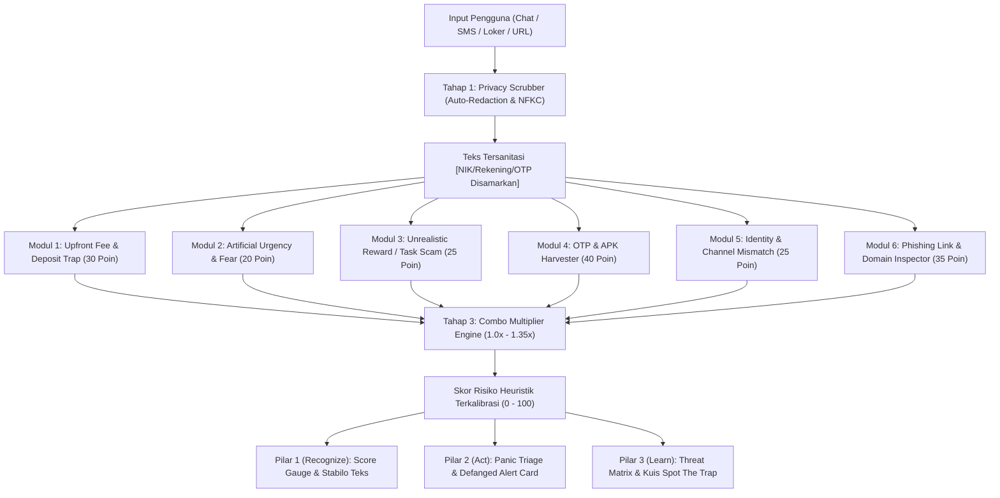

# 🏛️ Arsitektur Sistem TrustTrap Guardian
> **Dokumentasi Teknis & Spesifikasi Rekayasa Perangkat Lunak**  
> *Kompetisi Web Development MIT-WEEK 2026 — Tim Nanti Ajah (MIT-041) / Universitas Gunadarma*

---

## 1. Filosofi Desain: Mengapa Local-First & Explainable?

Sebagian besar korban penipuan digital di Indonesia (*social engineering*) mengalami **"Panic Paralysis"** — ketidakmampuan berpikir jernih saat ditekan batas waktu atau ancaman hukum palsu. TrustTrap Guardian dirancang dengan 3 prinsip fundamental:

1. **Zero-Knowledge Privacy (100% Client-Side):** Tidak ada satu byte pun data teks, NIK, nomor rekening, atau riwayat chat yang dikirim ke server luar. Semua pemrosesan selesai di dalam memori browser pengguna.
2. **Explainable Threat Evidence (Bukan Black-Box):** Alih-alih hanya memberikan skor angka tanpa alasan, sistem menyorot frasa manipulatif secara presisi (*Explainable AI/Heuristics*) dan menjelaskan modus psikologis di baliknya.
3. **HCI Psychological First Aid:** Antarmuka diarahkan untuk meredakan kepanikan, memandu tindakan berdasar waktu darurat, dan mematahkan lingkaran rasa malu (*Anti-Shame Loop*).

---

## 2. Alur Pemrosesan 4 Tahap (Pipeline Architecture)

---

## 3. Matriks 6 Modul Deteksi Heuristik

| ID Modul | Nama Modul | Kategori Ancaman | Bobot Dasar | Trik Psikologis yang Dieksploitasi | Pola / Regex Deteksi Utama |
|---|---|---|---|---|---|
| `upfront_fee` | **Upfront Fee & Deposit Trap** | Financial Manipulation | 30 | *Sunk Cost Fallacy* & Komitmen Bertingkat | `\b(?:me\|men\|di)?transfer\s+(?:biaya\|uang\|dana\|tiket\|reservasi\|admin\|deposit)\b`, `rekening penampung/sementara`, `alihkan saldo` |
| `artificial_urgency` | **Artificial Urgency & Fear** | Psychological Manipulation | 20 | *Fight-or-Flight Response* & Kepanikan | `dalam (?:15\|30\|10\|5) menit`, `sebelum kuota hangus`, `akun diblokir/dibekukan`, `denda keterlambatan` |
| `unrealistic_reward` | **Unrealistic Reward / Task Scam** | Deceptive Employment | 25 | *Greed Heuristic* & *Foot-in-the-Door* | `komisi harian rp[0-9]+`, `cukup like & subscribe`, `kerja dari hp tanpa modal`, `misi vip` |
| `apk_otp_harvester` | **OTP & APK Harvester** | Malware & Credential Theft | 40 | Kepercayaan terhadap Dokumen Resmi | `[a-zA-Z0-9_\-]+\.apk\b`, `kode otp`, `pin 6 digit`, `surat_.*\.apk`, `instal aplikasi` |
| `identity_mismatch` | **Identity & Channel Mismatch** | Brand Impersonation | 25 | *Authority Bias* & Prestise Brand | Pencatutan instansi BUMN/Bank dipadukan dengan kanal personal (`@gmail.com`, `ke WA ini`, `rekening bendahara`) |
| `phishing_link` | **Phishing Link & Domain Inspector** | Malicious Infrastructure | 35 | Penyamaran Visual & *Typosquatting* | Shortlinks (`bit.ly`, `s.id`), TLD berisiko (`.xyz`, `.top`), Spoofed Brands, serta **Shannon Entropy Ratio $\ge 0.85$** |

---

## 4. Algoritma Combo Multiplier & Shannon Entropy

### A. Combo Multiplier
Ketika beberapa modul menyala secara simultan, tingkat bahaya meningkat secara non-linear karena merefleksikan sindikat terorganisir:
- **Kombinasi 1 (Upfront Fee + Urgensi Waktu):** Pengali $+0.25\times$ (Pola desakan transfer cepat sebelum kuota hangus).
- **Kombinasi 2 (Imbalan Fantastis + Deposit Tugas):** Pengali $+0.30\times$ (Pola klasik *task scam* Ponzi).
- **Kombinasi 3 (APK/OTP + Pencatutan Instansi/Phishing):** Pengali $+0.35\times$ (Pola pembajakan akun m-banking terstruktur).

Formula Akhir:
$$\text{Final Score} = \min\left(100, \, \text{Round}\left(\sum \text{BaseWeight} \times \text{ComboBonus}\right)\right)$$

### B. Shannon Entropy pada Domain
Untuk mendeteksi domain acak hasil *Domain Generation Algorithm* (DGA) yang umum dipakai phishing:
$$H = -\sum_{i=1}^{n} p_i \log_2(p_i)$$
Jika $\frac{H}{\log_2(\text{len})} \ge 0.85$ pada domain berpanjang $\ge 8$ karakter tanpa TLD resmi, domain ditandai sebagai anomali berisiko tinggi.

---

## 5. Landasan Human-Computer Interaction (HCI)

1. **Hick's Law (Penyederhanaan Jalur Keputusan):** Mengurangi *choice overload* korban dengan menyediakan tombol filter kondisi biner: *Baru Terima Chat* vs *Terlanjur Klik / Transfer*.
2. **Cognitive Load Theory (Time-Boxed Emergency Cards):** Memisahkan tindakan kritis ke dalam 2 jendela waktu:
   - **Detik 0–30:** Putus koneksi malware `.APK` (Mode Pesawat).
   - **Menit 1–60:** Isolasi rekening di call center resmi kartu ATM.
3. **Affective Design / Anti-Shame Loop:** Banner penenang berlabel *Psychological First Aid* untuk menghapus rasa bersalah (*victim blaming*) agar korban segera melapor ke IASC OJK.
4. **Endowed Progress Effect:** Checklist tindakan darurat dimulai dari **15%** saat pertama dibuka sebagai dorongan psikologis awal agar korban termotivasi menyelesaikan seluruh protokol penyelamatan.

---

## 6. Standar Keamanan & Pertahanan Siber

- **URL Defanging:** Teks laporan resmi dan pesan yang disalin otomatis mendefang link (`http` $\to$ `hxxp`, `.xyz` $\to$ `[.]xyz`) agar korban tidak menyebarkan link aktif ke grup WhatsApp.
- **Unicode & Zero-Width Sanitizer:** Membersihkan karakter tak terlihat (`\u200B` s/d `\u200D`, `\uFEFF`) dan normalisasi NFKC sebelum teks diproses oleh engine.
- **HTTP Security Headers (`vercel.json`):** Menerapkan `Content-Security-Policy`, `X-Frame-Options: DENY`, `X-Content-Type-Options: nosniff`, dan `Referrer-Policy: strict-origin-when-cross-origin`.
- **Automated Regression Suite (`scripts/verifyEngine.mjs`):** 14 pengujian otomatis mencakup privasi, deteksi bahaya, dan *anti false-positive* pada pesan perbankan resmi.
