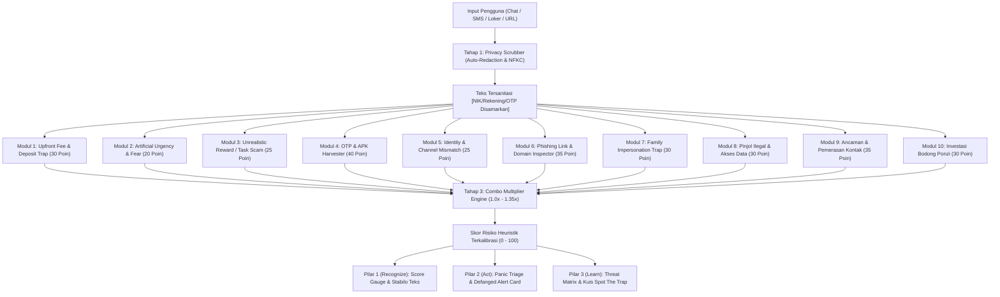

# 🏛️ Arsitektur Sistem TrustTrap Guardian
> **Dokumentasi Teknis & Spesifikasi Rekayasa Perangkat Lunak**  
> *Kompetisi Web Development MIT-WEEK 2026 - Tim Nanti Ajah (MIT-041) / Universitas Gunadarma*

---

## 1. Filosofi Desain: Mengapa Local-First & Explainable?

Sebagian besar korban penipuan digital di Indonesia (*social engineering*) mengalami **"Panic Paralysis"**, yaitu ketidakmampuan berpikir jernih saat ditekan batas waktu atau ancaman hukum palsu. Terinspirasi dari transparansi VirusTotal, sistem ini menyajikan deteksi pola heuristik yang dapat dijelaskan secara transparan, namun dijalankan sebagai satu set aturan berbasis pola sisi klien tanpa ketergantungan server luar. TrustTrap Guardian dirancang dengan 3 prinsip fundamental:

1. **Local-First Privacy (100% Client-Side):** Tidak ada satu byte pun data teks, NIK, nomor rekening, atau riwayat chat yang dikirim ke server luar. Semua pemrosesan selesai di dalam memori browser pengguna.
2. **Explainable Threat Evidence (Bukan Black-Box):** Alih-alih hanya memberikan skor angka tanpa alasan, sistem menyorot frasa manipulatif secara presisi (*Explainable Heuristics*) dan menjelaskan modus psikologis di baliknya.
3. **HCI Psychological First Aid:** Antarmuka diarahkan untuk meredakan kepanikan, memandu tindakan berdasar waktu darurat, dan mematahkan lingkaran rasa malu (*Anti-Shame Loop*).

---

## 2. Alur Pemrosesan 4 Tahap (Pipeline Architecture)

---

## 3. Matriks 10 Modul Deteksi Heuristik

| ID Modul | Nama Modul | Kategori Ancaman | Bobot Dasar | Trik Psikologis yang Dieksploitasi | Pola / Regex Deteksi Utama |
|---|---|---|---|---|---|
| `upfront_fee` | **Upfront Fee & Deposit Trap** | Financial Manipulation | 35 | *Sunk Cost Fallacy* & Komitmen Bertingkat | `\b(?:me\|men\|di)?transfer\s+(?:biaya\|uang\|dana\|tiket\|reservasi\|admin\|deposit)\b`, bayar/transfer (seragam/pelatihan/training/berkas/medical/alat kerja), `rekening penampung/sementara`, `alihkan saldo` |
| `artificial_urgency` | **Artificial Urgency & Fear** | Psychological Manipulation | 20 | *Fight-or-Flight Response* & Kepanikan | `dalam (?:15\|30\|10\|5) menit`, `sebelum kuota hangus`, `akun diblokir/dibekukan`, `denda keterlambatan`, `darurat`, `penting banget` |
| `unrealistic_reward` | **Unrealistic Reward / Task Scam** | Deceptive Employment | 25 | *Greed Heuristic* & *Foot-in-the-Door* | `komisi harian rp[0-9]+`, `cukup like & subscribe`, `kerja dari hp tanpa modal`, `misi vip` |
| `apk_otp_harvester` | **OTP & APK Harvester** | Malware & Credential Theft | 40 | Kepercayaan terhadap Dokumen Resmi | `[a-zA-Z0-9_\-]+\.apk\b`, `kode otp`, `pin 6 digit`, `surat_.*\.apk`, `instal/download aplikasi` |
| `identity_mismatch` | **Identity & Channel Mismatch** | Brand Impersonation | 25 | *Authority Bias* & Prestise Brand | Pencatutan instansi BUMN/Bank dipadukan dengan kanal personal (`@gmail.com`, `ke WA ini`, `rekening bendahara`) |
| `phishing_link` | **Phishing Link & Domain Inspector** | Malicious Infrastructure | 35 | Penyamaran Visual & Brand Spoofing | Shortlinks (`bit.ly`, `s.id`), TLD berisiko (`.xyz`, `.top`), Brand Spoofing (nama brand + kata pancingan), serta **Shannon Entropy Ratio $\ge 0.85$** |
| `family_impersonation` | **Family Impersonation Trap** | Social Engineering | 35 | *Empathy Exploitation* & Kepanikan Keluarga | Co-occurrence dua kelompok: Status kerabat (nomor baru/ganti nomor/hp rusak/anakmu/darurat RS) + Permintaan finansial (pulsa/transfer/kirim uang/rekening) |
| `illegal_loan` | **Pinjol Ilegal & Akses Data Sensitif** | Predatory Lending | 30 | *Desperation & False Ease* | Minimal 2 pola cocok: Pinjaman kilat cair, tanpa jaminan/SLIK, proses hitungan menit, dan paksaan izin akses kontak/galeri |
| `threat_extortion` | **Ancaman & Pemerasan Kontak** | Coercion & Extortion | 35 | *Fear, Intimidation & Blackmail* | Ancaman sebar foto/data/video/kontak keluarga, teror kontak, dan ultimatum bayar hutang/tagihan hari ini atau disebarkan |
| `investment_scam` | **Investasi Bodong & Skema Ponzi** | Financial Fraud | 30 | *Greed Bias & Social Proof Trap* | Janji profit berkala tidak wajar (% per hari/minggu/bulan), klaim dijamin cuan, member VIP, modal minimal, dan ajakan grup chat privat |

---

## 4. Algoritma Combo Multiplier & Shannon Entropy

### A. Combo Multiplier
Ketika beberapa modul menyala secara simultan, tingkat bahaya meningkat secara non-linear karena merefleksikan pola sindikat terorganisir:
- **Kombinasi 1 (Upfront Fee + Urgensi Waktu):** Pengali $+0.25\times$ (Pola desakan transfer cepat sebelum kuota hangus).
- **Kombinasi 2 (Imbalan Fantastis + Deposit Tugas):** Pengali $+0.30\times$ (Pola klasik *task scam* Ponzi).
- **Kombinasi 3 (APK/OTP + Pencatutan Instansi/Phishing):** Pengali $+0.35\times$ (Pola pembajakan akun m-banking terstruktur).
- **Kombinasi 4 (Penyamaran Kerabat + Uang Muka/Urgensi):** Pengali $+0.30\times$ (Pola manipulasi emosional keluarga tertimpa musibah).
- **Kombinasi 5 (Pinjol Ilegal + Pemerasan Kontak):** Pengali $+0.30\times$ (Pola jeratan pinjaman predatory disertai intimidasi kontak).
- **Kombinasi 6 (Investasi Bodong + Setoran Modal):** Pengali $+0.30\times$ (Pola pengumpulan dana berkedok member VIP berbayar).

Formula Akhir:
$$\text{Final Score} = \min\left(100, \, \text{Round}\left(\sum \text{BaseWeight} \times \text{ComboBonus}\right)\right)$$

### B. Shannon Entropy pada Domain
Untuk mendeteksi domain acak hasil *Domain Generation Algorithm* (DGA) yang umum dipakai phishing:
$$H = -\sum_{i=1}^{n} p_i \log_2(p_i)$$
Jika $\frac{H}{\log_2(\text{len})} \ge 0.85$ pada domain berpanjang $\ge 8$ karakter tanpa TLD resmi, domain ditandai sebagai anomali berisiko tinggi.

---

## 5. Landasan Human-Computer Interaction (HCI)

1. **Hick's Law (Penyederhanaan Jalur Keputusan):** Mengurangi *choice overload* korban dengan menyediakan tombol filter kondisi biner: *Baru Terima Chat* vs *Terlanjur Klik / Transfer*.
2. **Cognitive Load Theory (Time-Boxed Emergency Cards):** Memisahkan tindakan kritis ke dalam 2 jendela waktu:
   - **Detik 0-30:** Putus koneksi malware `.APK` (Mode Pesawat).
   - **Menit 1-60:** Isolasi rekening di call center resmi kartu ATM.
3. **Affective Design / Anti-Shame Loop:** Banner penenang berlabel *Psychological First Aid* untuk menghapus rasa bersalah (*victim blaming*) agar korban segera melapor ke IASC OJK.
4. **Endowed Progress Effect:** Checklist tindakan darurat dimulai dari **15%** saat pertama dibuka sebagai dorongan psikologis awal agar korban termotivasi menyelesaikan seluruh protokol penyelamatan.

---

## 6. Standar Keamanan & Pertahanan Siber

- **URL Defanging:** Teks laporan resmi dan pesan yang disalin otomatis mendefang link (`http` $\to$ `hxxp`, `.xyz` $\to$ `[.]xyz`) agar korban tidak menyebarkan link aktif ke grup WhatsApp.
- **Unicode & Zero-Width Sanitizer:** Membersihkan karakter tak terlihat (`\u200B` s/d `\u200D`, `\uFEFF`) dan normalisasi NFKC sebelum teks diproses oleh engine.
- **HTTP Security Headers (`vercel.json`):** Menerapkan `Content-Security-Policy`, `X-Frame-Options: DENY`, `X-Content-Type-Options: nosniff`, dan `Referrer-Policy: strict-origin-when-cross-origin`.
- **Automated Regression Suite (`scripts/verifyEngine.mjs`):** 32 pengujian otomatis mencakup privasi, deteksi bahaya, anti false-positive pesan resmi, dan validasi seluruh 10 modul heuristik.

---

## 7. Keterbatasan yang Diketahui (Known Limitations)

Sebagai wujud kejujuran ilmiah dan kepatuhan etis:
1. **Berbasis Pola Kata & Frasa:** Analisis mengandalkan aturan pencocokan pola heuristik dan regex, bukan model bahasa alami (NLP) probabilistik berskala besar.
2. **Cakupan Bahasa:** Deteksi saat ini dioptimalkan khusus untuk bahasa Indonesia dan istilah percakapan digital lokal.
3. **Potensi Terlewat (False Negative):** Modus penipuan baru atau teks yang diparafrasekan secara sangat halus mungkin tidak memicu aturan deteksi yang ada.
4. **Potensi Salah Tandai (False Positive):** Pesan sah yang secara kebetulan memuat kombinasi kata peringatan atau istilah darurat dapat memicu kenaikan skor risiko.
5. **Tanpa Verifikasi Daring:** Sistem beroperasi 100% lokal di browser pengguna dan tidak memverifikasi nomor rekening bank, nomor telepon, atau reputasi domain secara daring ke server pihak ketiga.
6. **Bukan Jaminan Aman:** Skor risiko 0 ("TIDAK TERDETEKSI") berarti tidak ditemukan pola manipulasi umum, bukan jaminan mutlak bahwa suatu pesan pasti 100% aman.
